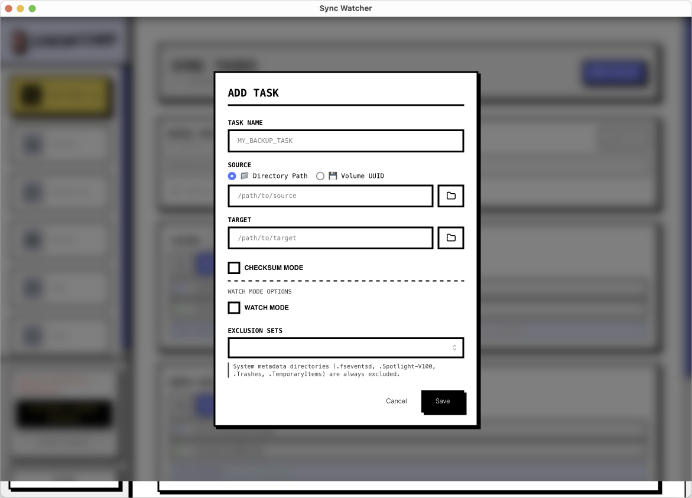
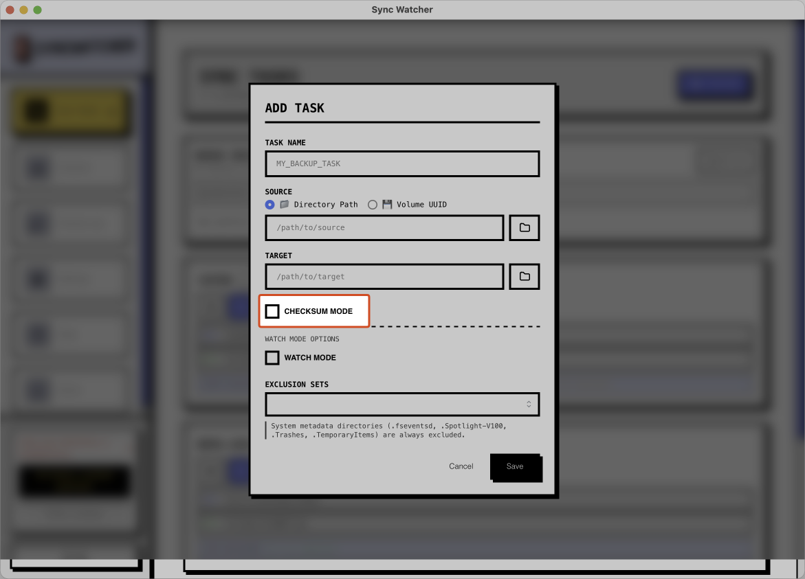
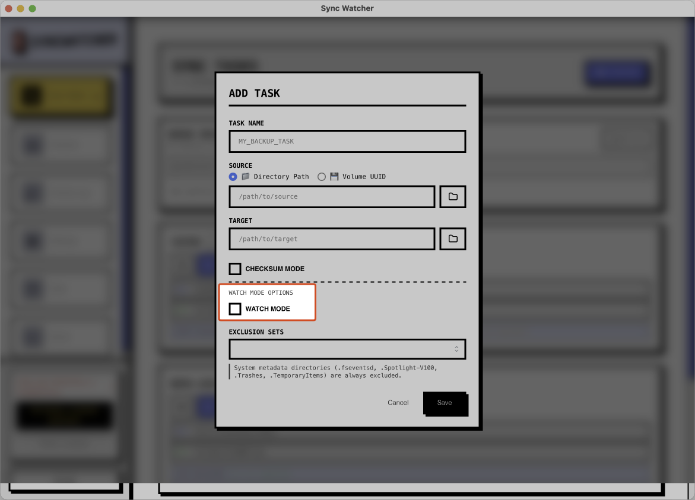
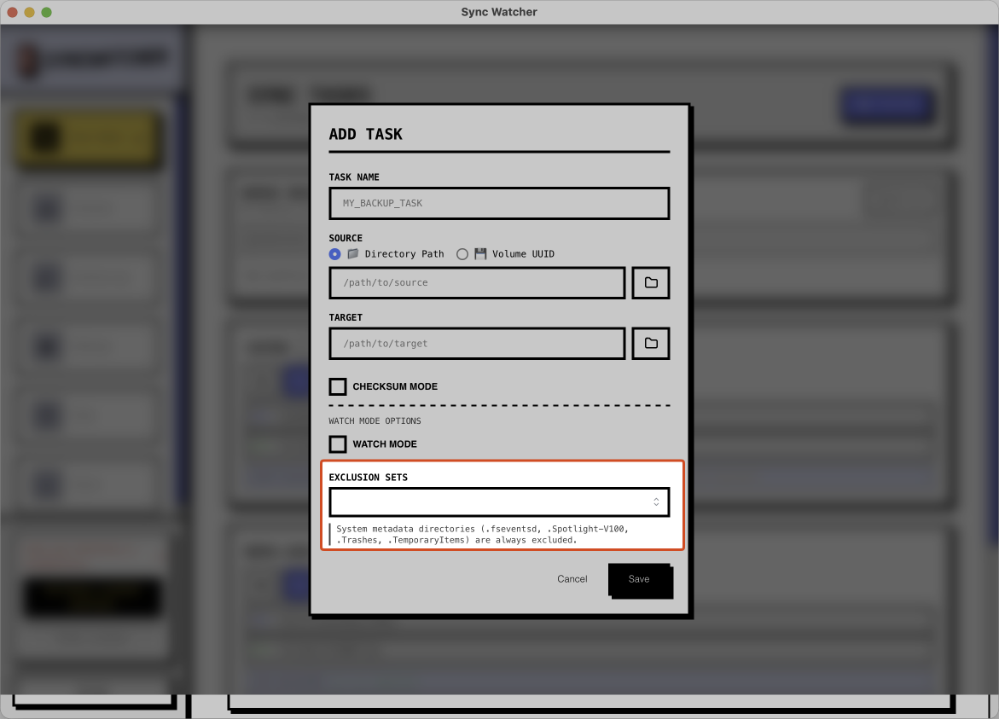

# SyncTask Guide

SyncTask는 SyncWatcher 안에서 반복 사용하는 백업 작업 단위입니다. Source, Target, 그리고 복사 동작 방식을 함께 저장합니다.

## 대시보드

대시보드는 사용자가 가장 먼저 보게 되는 화면으로, 작업 상태와 진행 상황, 빠른 제어 버튼을 한 곳에서 보여줍니다.

## 작업 추가 / 편집

Source, Target, 동작 옵션을 선택해서 새 SyncTask를 만들거나 기존 작업을 수정할 수 있습니다.

반복되는 작업 흐름을 빠르게 조정할 수 있도록 주요 설정을 한 화면에 모아둡니다.

## 이동식 저장장치 대상

SD 카드 같은 이동식 디스크를 Target으로 선택할 수 있습니다. `watchmode`와 조합하면 자동 복사 후 자동 꺼내기 흐름에도 맞출 수 있습니다.

## 체크섬 모드

체크섬 모드는 속도보다 복사 후 검증이 더 중요한 경우에 사용합니다. 복사 완료 후 다시 검사해서 결과 신뢰도를 높입니다.

## Watch Mode

`watchmode`를 켜면 Source 폴더 변경을 감지할 때마다 SyncWatcher가 자동으로 새 복사 작업을 시작합니다.

## 제외할 파일 유형

복사에서 제외할 파일 유형을 선택할 수 있습니다. 추가 패턴은 `Settings`에서 등록할 수 있습니다.

## 저장 규칙

작업 편집기에서 **저장 규칙**을 고르면 원본 폴더 구조를 그대로 복사하는 대신, 복사되는 파일을 폴더별로 나누고 이름을 바꿔 저장합니다. 기본값인 *원본 폴더 구조 그대로*는 이전과 완전히 같은 동작입니다.

기본 제공 템플릿:

- **Camera: by file type** - `Proxy/`, `Video/`, `RAW/`, `Photo/`, `Metadata/`, `Other/` 폴더로 분류하고 파일명은 그대로 둡니다.
- **Camera: by capture date, then type** - `2026-10-22/RAW/DSC00001.ARW`처럼 촬영 날짜 폴더 안에 종류별 폴더를 만듭니다.
- **Camera: by capture date** - `2026/2026-10-22/DSC00001.ARW`처럼 종류 구분 없이 날짜별로 모읍니다.
- **Camera: dated folders and file names** - `2026-10-22/RAW/20261022_140355_DSC00001.ARW`처럼 파일명 앞에 촬영 일시를 붙입니다.

템플릿은 `설정` > `저장 규칙 템플릿`에서 편집합니다. 템플릿은 규칙 목록이며, 각 규칙은 파일 종류(프록시·동영상·RAW·사진·메타데이터·기타)나 확장자를 조건으로 폴더 템플릿과 파일명 템플릿을 정합니다. 먼저 일치하는 규칙이 적용되고, 어느 규칙에도 맞지 않는 파일은 원본 상대 경로를 유지합니다. `{yyyy}`, `{MM}`, `{dd}`, `{HH}`, `{mm}`, `{ss}`, `{datetime}`, `{name}`, `{ext}`, `{category}`, `{camera}`, `{iso}`, `{fnumber}`, `{shutter}` 같은 토큰은 촬영 날짜와 EXIF 값으로 채워지며, 편집기에서 샘플 파일 기준 미리보기를 바로 볼 수 있습니다.

촬영 시각과 카메라 정보는 JPEG, HEIF/HEIC, TIFF 계열 RAW(ARW, NEF, CR2, DNG, ORF, RW2, RAF 등)에서 읽습니다. MP4/MOV 클립은 Sony XML 사이드카가 있으면 그 값을, 없으면 파일 헤더를 사용합니다. 지원하지 않는 형식(CR3, MXF, AVI 등)은 파일 수정 시각을 씁니다.

Dry Run과 동기화 결과에서는 저장 경로가 원본과 다른 파일 옆에 `→ 저장 경로`가 표시되고, 삭제 후보 파일 탐색도 바뀐 폴더 구조를 기준으로 동작합니다.

## Task 카드 제어

1. 체크섬 모드 표시
2. `watchmode` 활성화 표시
3. `autounmount` 모드 표시
4. 복사 없이 미리 확인하는 `dry-run` 버튼
5. 수동 복사 실행 버튼
6. `watchmode` 토글 버튼
7. Target에만 남아 있는 항목을 찾는 삭제 항목 탐색 기능

`dry-run`이 끝나면 결과 화면에서 바로 `지금 동기화`를 실행할 수 있습니다. 수동 sync 화면도 실제 복사 전에 scan / compare 단계와 현재 검사 중인 경로를 보여주므로, 멈춘 것처럼 보이지 않고 진행 중임을 확인할 수 있습니다.
